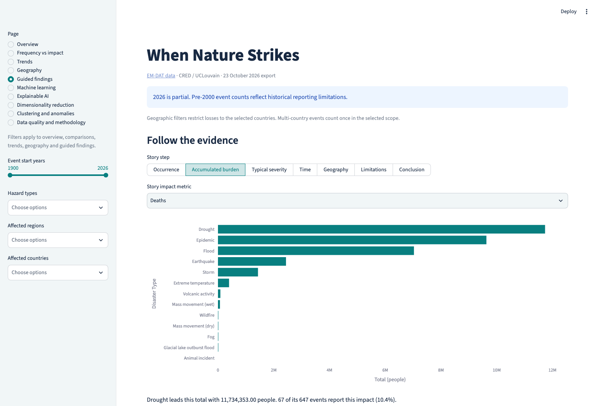

# When Nature Strikes

**A Visualization Approach to Determine the Impact of Natural Disasters**

Are the most frequent natural disasters also the most destructive? In the
23 October 2026 EM-DAT export, floods occur most often (5,814 of 15,727
distinct events) and lead total reported affected population. Storms lead
total adjusted damage. Earthquakes lead mean adjusted damage. Historical
droughts lead total and mean reported mortality, while earthquakes lead
both in 2000–2025. The result depends on the impact measure, aggregation,
reporting coverage and time window.

## Windows quick start

Follow [Start here on Windows](WINDOWS_HANDOVER/START_HERE.md). The package
contains a ten-view Streamlit dashboard and a five-page native Power BI PBIP.
Run either dashboard with the included synthetic data to exercise controls
before obtaining the authorized workbook. The completion matrix records the
native PBIX and Desktop verification status. The [deliverables manifest](submission/DELIVERABLES_MANIFEST.md)
indexes the package, and [Desktop acceptance steps](NEXT_SESSION.md) give the
commands to resume the native check.



## Explore the project

- [Research report](submission/final_report.pdf) and [editable Word file](submission/final_report.docx)
- [Presentation](submission/final_presentation.pdf) and [editable slides](submission/final_presentation.pptx)
- [Demonstration and viva material](submission/README.md)
- [Dashboard guide](docs/DASHBOARD_GUIDE.md) and [native Power BI project and build instructions](dashboard/powerbi/README.md)
- [Validation evidence](docs/VALIDATION_REPORT.md), [project audit](docs/PROJECT_AUDIT.md) and [task ledger](docs/PROJECT_TASK_LEDGER.md)

## Data and attribution

This repository is public. The analysis uses **EM-DAT, CRED / UCLouvain,
Brussels, Belgium**, custom-request export version **2026-10-23**, delivered
31 October 2026. The full source and processed data are local inputs and outputs.
Earlier public commits contained the workbook and all four CSVs. The current
branch removes those paths from its tracked tree and retains Git history.
See the [provenance, historical exposure and terms](docs/DATA_LICENSE.md).

Eligible users can request data at the [EM-DAT portal](https://public.emdat.be/)
under the [Terms of Use](https://doc.emdat.be/docs/legal/terms-of-use/). The
project has no evidence of separate permission to redistribute this export or
its row-level derivatives. Cite the snapshot and provider per the
[EM-DAT citation policy](https://doc.emdat.be/docs/legal/citation-policy/).
Natural Earth supplies the [public-domain country boundaries](https://www.naturalearthdata.com/about/terms-of-use/).

## Reproduce the analysis

Use Python 3.11. Place the authorized workbook at the path specified in
[data/source](data/source/README.md). A later export can change the findings
and may fail the snapshot-specific assertions.

```sh
python3.11 -m venv .venv
source .venv/bin/activate
python -m pip install -r requirements.txt
python scripts/prepare_emdat.py > results/provenance.json
python scripts/validate_project_data.py
python scripts/verify_eda_findings.py
python -m src.statistics
python -m src.model
python -m src.xai
python -m src.profiles
python -m src.geography
python -m unittest discover -s tests -v
python scripts/check_submission.py
python -m streamlit run dashboard/app.py --server.port 8765
```

Open [the dashboard at localhost](http://127.0.0.1:8765). Event year, hazard,
region and country filters persist across the four descriptive views and guided findings. The app uses local
files and binds to loopback by default. The browser test and screenshot
commands are in the [dashboard guide](docs/DASHBOARD_GUIDE.md).
The [submission guide](submission/README.md) documents Office and PDF rebuilds.
Use `requirements-ci.txt` for tests that can run without the workbook.

## How to interpret the results

- **Data engineering.** The pipeline prepares separate country-impact and
  consolidated event tables, plus type and country/year/type summaries.
  Worldwide frequency counts each Event ID once. Missing losses stay blank,
  and each loss summary has a reporting count and grain. Legacy magnitude
  sums exist for schema compatibility and are excluded from the new analyses.
- **EDA and statistics.** Compare nine impact rankings with reporting coverage, robust
  summaries, era sensitivity and rank correlations. Deaths, affected and
  adjusted damage report for 74.1%, 78.6% and 33.4% of events, respectively.
  The six historical notebooks remain in `analysis/`.
- **Classification and SHAP.** A chronological holdout measures retrospective
  high-mortality ranking for single-country events with known deaths.
  Logistic regression reached test AP 0.288 versus 0.116 for the prior baseline.
  The explanation view compares grouped SHAP, held-out permutation, local LIME and categorical month PDP/ICE.
- **Impact profiles.** PCA, t-SNE and UMAP visualize the same 1,821 fully reporting
  recent events. K-means, DBSCAN and Isolation Forest probe local structure.
  The dashboard includes 2D and 3D PCA, t-SNE, UMAP, cluster diagnostics and anomaly summaries. Exact event coordinates are rebuilt locally.
- **Geography.** Country and region aggregates use records in that geographic
  scope. Contemporary ISO-mapped boundaries matched 17,269 of 18,060 records.
  Unmatched historical codes and small territories remain in the rankings.
- **Limitations.** 2026 is partial. Pre-2000 coverage is uneven. Reported losses
  and affected counts omit unknown values and can represent repeated impacts.
  Country totals are unnormalized. The analysis supports descriptive
  comparisons and conditional retrospective results.

## Repository map

| Path | Evidence |
| --- | --- |
| [scripts](scripts/) and [src](src/) | Rebuild, validators, analyses, charts and academic builders |
| [analysis](analysis/) and [visualizations](visualizations/) | Original notebooks, aggregate tables and EDA charts |
| [results](results/) | New aggregate results and figures. Row-level products stay local. |
| [dashboard](dashboard/) | Streamlit application and Power BI authoring package |
| [docs](docs/) | Methodology, [literature matrix](docs/LITERATURE_REVIEW.md), [data dictionary](docs/DATA_DICTIONARY.md) and [contributions](docs/TEAM_CONTRIBUTIONS.md) |
| [submission](submission/) | Academic artifacts, native Power BI project, screenshots and [completion matrix](submission/COMPLETION_MATRIX.csv) |
| [WINDOWS_HANDOVER](WINDOWS_HANDOVER/) | PowerShell install, rebuild, tests, browser launch and Power BI save instructions |
| [tests](tests/) | Core regression and full-browser acceptance |

The [team handover](docs/TEAM_HANDOVER.md) lists the institutional review steps.
